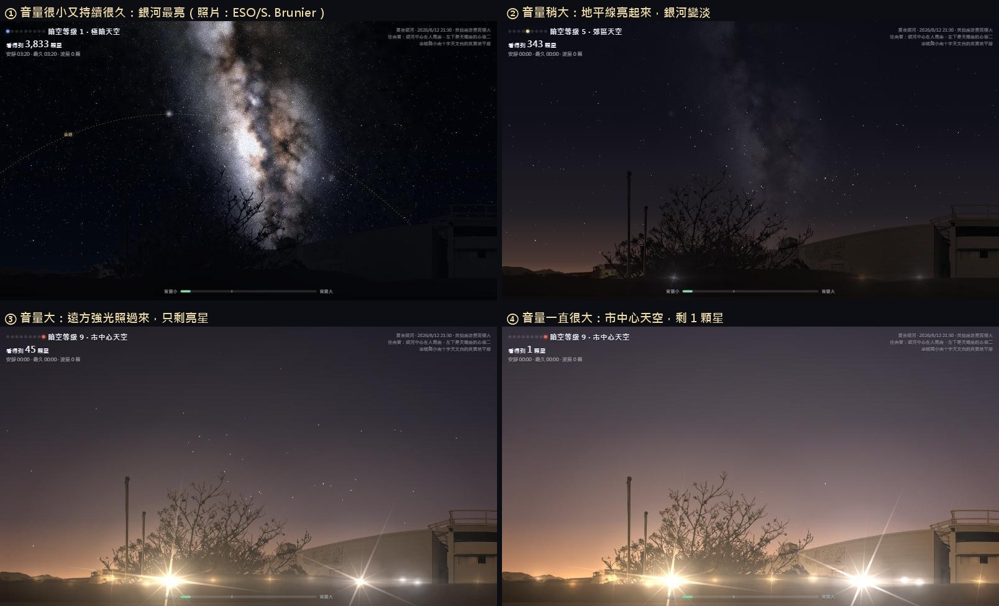

# 安靜星空 · 車城國小 南十字天文台

網頁：https://cces026.github.io/cces-crux-quiet-sky/

自習課投影用：教室音量越小，天空越暗，星星、銀河、流星和行星連線一一出現；
音量一大，遠方的燈亮起來、光暈照過來，光害把星空蓋掉。

- 用 Chrome 或 Edge 打開網址，按「開始」並允許麥克風。聲音只在打開網頁的那台電腦上換算成音量，不錄音、不上傳。
- 沒有麥克風可以用「示範模式」。
- 安靜越久，人造衛星、國際太空站、星雲星團、黃道光、火流星會陸續出現；每種第一次看到就收進「星空圖鑑」（存在打開網頁的那台電腦，按 B 打開）。
- 地平線是天文台全天攝影機拍的真實 360° 景色；星星來自耶魯亮星星表（BSC5）；三個場景的日期、時間、行星位置都是真的。
- 銀河照片：ESO/S. Brunier（The Milky Way panorama，CC BY 4.0），已去掉星點、對準銀道座標。

這個 repo 的內容由天文台電腦上的程式產生，請不要直接在這裡改。
